<div align="center">

# THE ABYSS

**Um ecossistema abissal vivo, compartilhado e persistente: um observatório de vida artificial na web.**

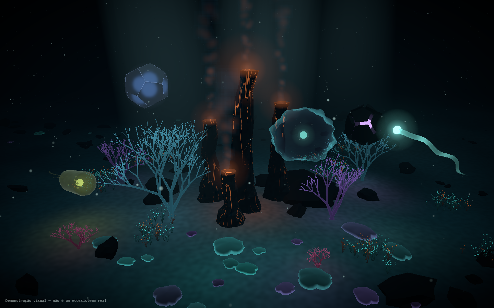

[**theabyss.andrearcodaci.com**](https://theabyss.andrearcodaci.com) ·
[Especificação](SPEC.md) ·
[Direção de arte](docs/ART_DIRECTION.md) ·
[Deploy](docs/VPS_DEPLOY.md)

</div>

---

## O que é

**The Abyss** é um fundo de oceano que nunca para. Organismos artificiais nadam, comem, crescem, se dividem,
mutam, caçam uns aos outros e às vezes somem de vez. Tudo isso acontece num **único mundo no servidor**, o mesmo
para todos os visitantes, e continua enquanto ninguém está olhando.

O visitante **observa**. Pode seguir uma criatura, abrir a ficha dela, buscar uma espécie e ver a árvore de
descendentes. A única intervenção permitida é **criar uma espécie**, uma por e-mail verificado. Depois de solta,
ela é do abismo: o criador não controla nada e não garante a sobrevivência dela.

> **Princípios.** Direção de arte em primeiro lugar · observar em vez de comandar · consequências em vez de
> roteiro · história persistente · complexidade com limite, viável para uma pessoa só manter.

---

## O mundo

O mapa tem três regiões. Cada uma tem papel ecológico próprio, não só uma cor diferente.

<table>
  <tr>
    <td width="33%" valign="top">
      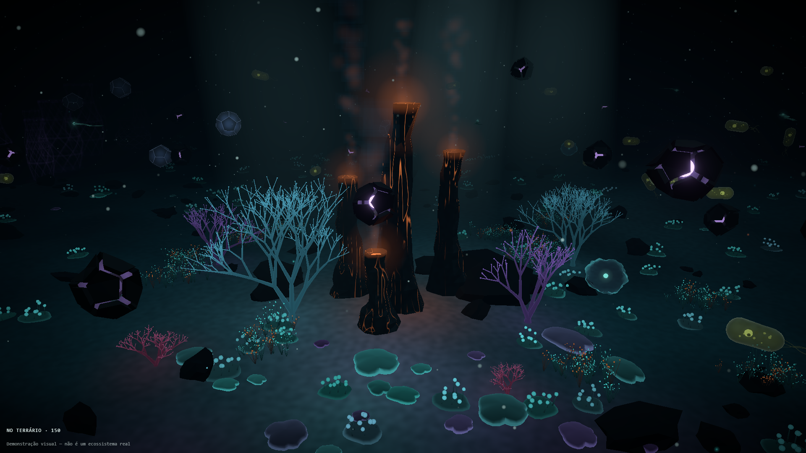
      <b>Jardim Hidrotermal</b><br>
      Chaminés, corais e tufos luminosos. Rico em <b>flora</b>, a comida de quem raspa.
    </td>
    <td width="33%" valign="top">
      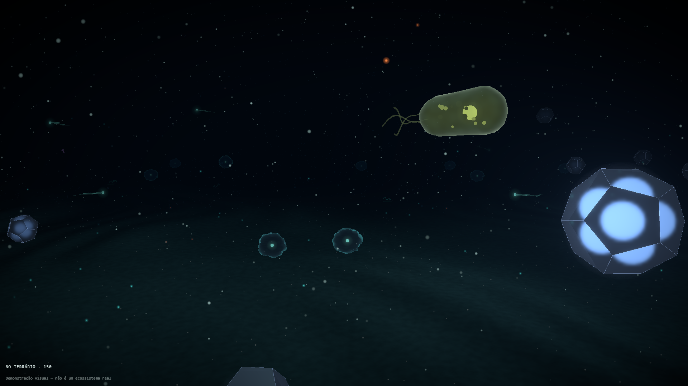
      <b>Planície da Neve Marinha</b><br>
      Aberta e escura. Rica em <b>partículas</b>: restos de seres que já viveram, que se apagam com o tempo.
    </td>
    <td width="33%" valign="top">
      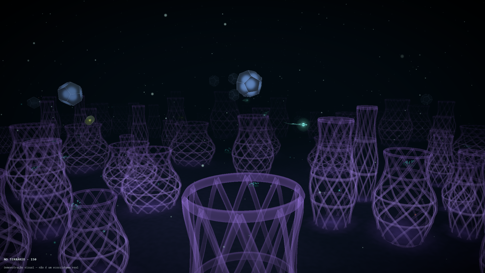
      <b>Floresta de Esponjas de Vidro</b><br>
      Treliças violeta. Pouca comida, mas é <b>abrigo</b> contra predadores.
    </td>
  </tr>
</table>

<p align="center">
  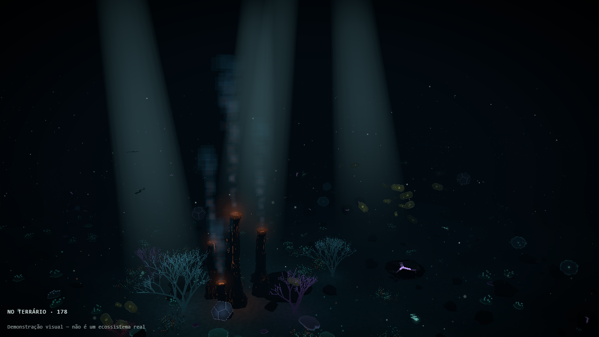
  <br><sub>Vista ampla. No canto, <code>NO TERRÁRIO · 178</code>: quantas criaturas estão vivas agora.</sub>
</p>

---

## Ciclo de vida

Cada criatura tem **energia**. Comer enche, nadar e manter o corpo gastam. O resto vem daí.

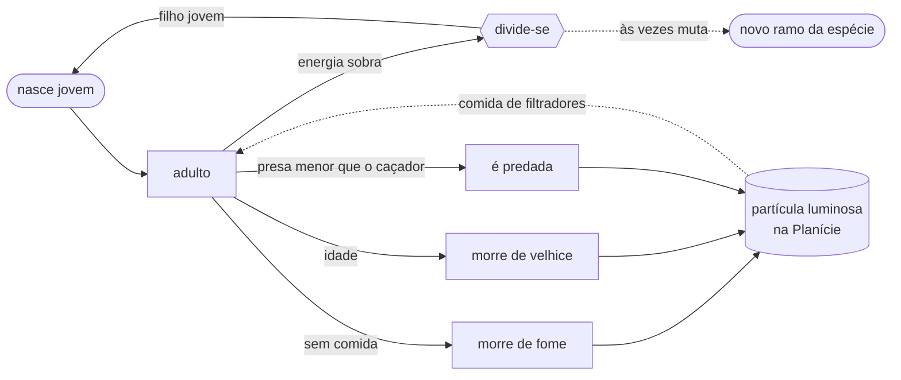

<table>
  <tr>
    <td width="50%">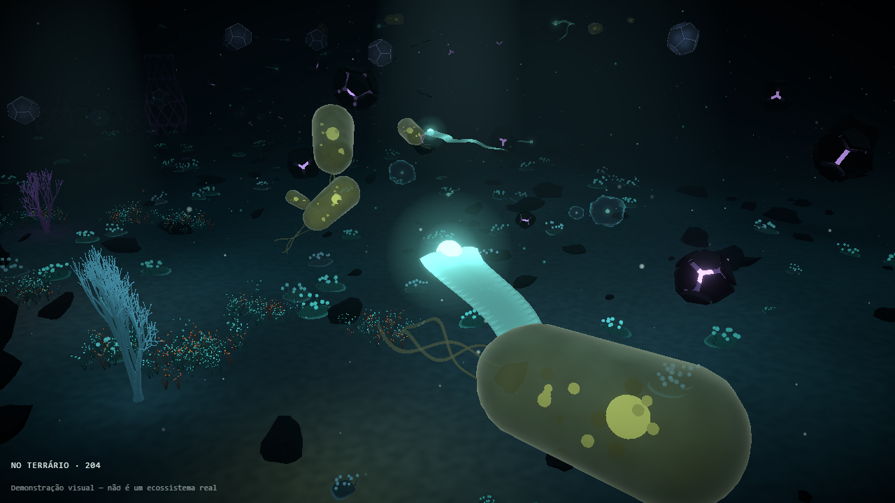</td>
    <td width="50%">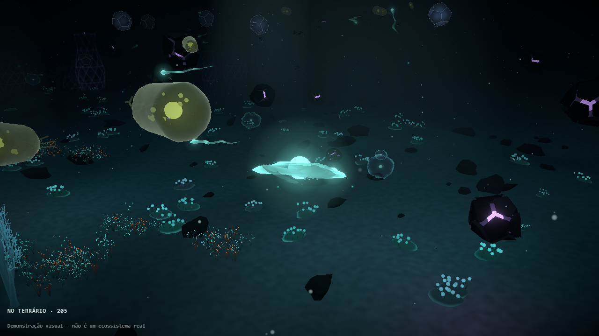</td>
  </tr>
  <tr>
    <td><sub><b>Predação pelo porte.</b> Quem tem mandíbula caça o que é menor. A presa foge para o abrigo, e o caçador que desiste ignora aquela presa por um tempo.</sub></td>
    <td><sub><b>Divisão.</b> Com energia sobrando, a criatura se alonga e se divide. O filho nasce jovem e menor.</sub></td>
  </tr>
</table>

O brilho de cada criatura acompanha a energia dela. Quando uma espécie perde o último indivíduo, a
**extinção é permanente** e fica registrada com a causa.

---

## Criar uma espécie

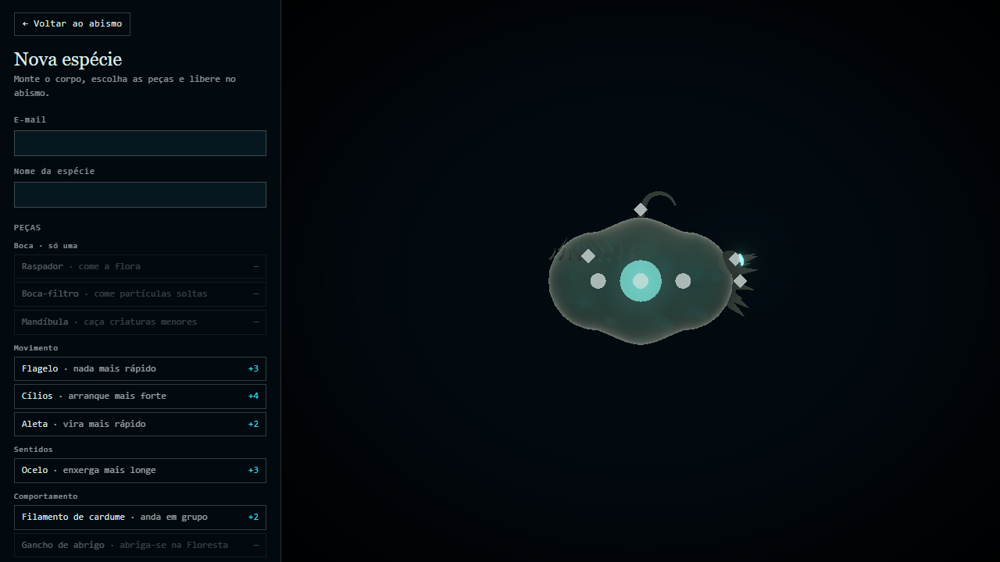

Na tela de criação (`#criar`) você monta o **corpo** (de 3 a 6 pontos de uma espinha, com raio e padrão: liso,
manchas, listras ou anéis) e encaixa **peças**, tudo com um orçamento de **24 pontos**. Cada peça custa pontos e
gasta energia o tempo inteiro.

| Grupo | Peça | O que faz | Custo |
|---|---|---|---:|
| **Boca** (só uma) | Raspador | come a flora do Jardim | 2 |
| | Boca-filtro | come partículas soltas | 2 |
| | Mandíbula | caça criaturas menores, enxerga mais | 4 |
| **Movimento** | Flagelo | nada mais rápido | 3 |
| | Cílios | arranque mais forte | 2 |
| | Aleta | vira mais rápido | 2 |
| **Sentidos** | Ocelo | enxerga mais longe | 2 |
| **Comportamento** | Filamento de cardume | anda em grupo | 2 |
| | Gancho de abrigo | abriga-se na Floresta | 2 |
| **Defesa** | Placa | escapa melhor, nada um pouco mais devagar | 3 |

Peças repetidas rendem menos a cada cópia. O catálogo inteiro está em
[`shared/genesis/catalog-s1.json`](shared/genesis/catalog-s1.json), lido pelo cliente e pelo servidor.

Para liberar no abismo: e-mail e nome da espécie → chega um link de confirmação → ao confirmar, **3 criaturas
nascem num lugar sorteado**. Um e-mail, uma espécie.

<p align="center">
  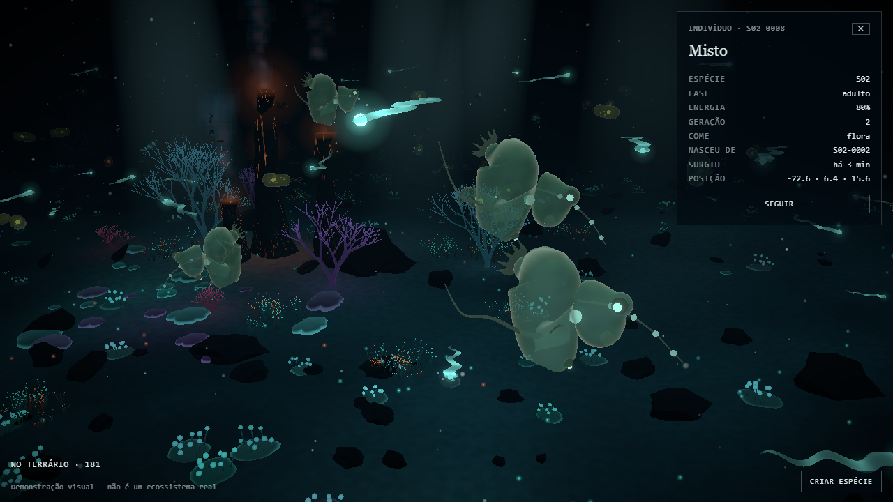
  <br><sub>Uma espécie criada no Jardim. Clicar numa criatura abre a ficha: espécie, fase, energia, geração, dieta, mãe, idade, posição.</sub>
</p>

---

## Evolução e história

Quando uma criatura se divide, às vezes o filho **muta**: ganha, perde ou troca uma peça, ou o corpo deriva um
pouco. Se a mudança pega, nasce um **ramo** da espécie, com nome próprio (`Semente 8 · Planície 2`) e a
diferença de peças registrada.

<table>
  <tr>
    <td width="50%">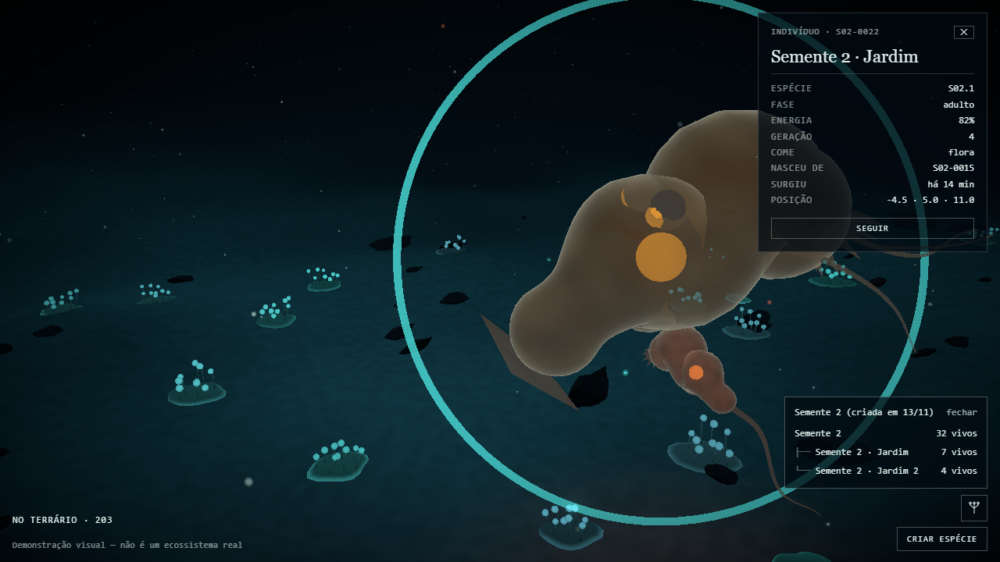</td>
    <td width="50%">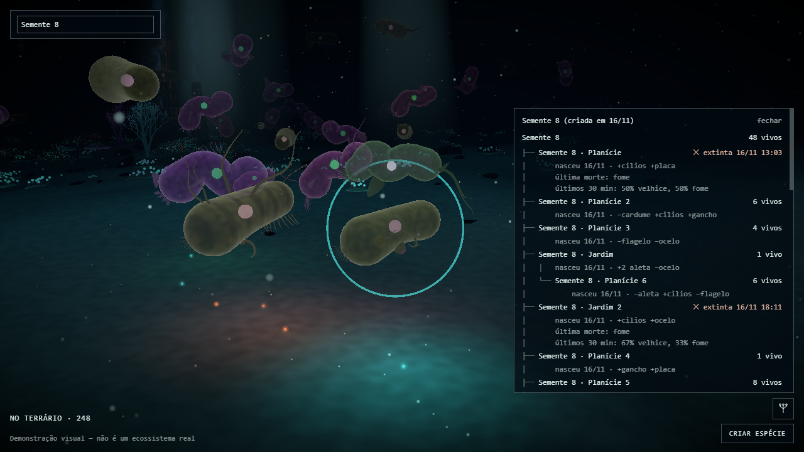</td>
  </tr>
  <tr>
    <td><sub><b>Ramos vivos.</b> A árvore da espécie seguida mostra quantos vivem em cada ramo. Clicar num ramo leva a câmera até uma criatura dele.</sub></td>
    <td><sub><b>A história inteira.</b> Busca por nome, ramos com o que mudou (<code>+cílios −ocelo</code>), extinções com data e causa, e as mortes dos últimos 30 minutos.</sub></td>
  </tr>
</table>

O mundo **sobrevive a reinícios**: o estado inteiro é fotografado a cada 60 s e no desligamento, e na volta o
relógio do mundo continua de onde parou. O tempo do abismo não corre enquanto o servidor está fora.

---

## Arquitetura

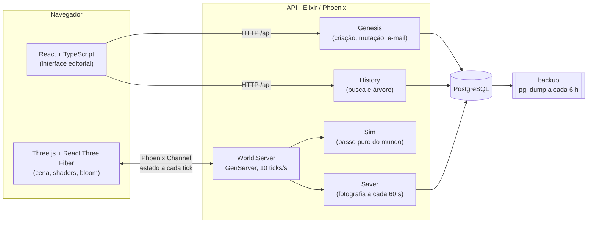

- **Servidor autoritativo.** Um único processo (`Abyss.World.Server`) é dono do mundo e avança a simulação pura
  (`Abyss.World.Sim`) em cadência fixa, agendada contra o relógio monotônico, sem deriva. Cada tick vai para todos
  os observadores pelo canal.
- **Cliente que só desenha.** O navegador interpola o que recebe e cuida do visual: geometria procedural de corais e
  esponjas, shaders GLSL próprios, névoa, bloom e vinheta. Há um perfil leve para GPU integrada (`?quality=low`).
- **Regras compartilhadas.** O catálogo de peças em `shared/` é o mesmo dos dois lados, e a validação de verdade
  acontece no servidor.

| Camada | Tecnologia |
|---|---|
| Cena 3D | Three.js, React Three Fiber, drei, postprocessing, GLSL |
| Interface | React 19, TypeScript, Vite |
| Servidor | Elixir, Phoenix 1.8 (Channels, Bandit), OTP |
| Dados | PostgreSQL via Ecto |
| E-mail | Swoosh (caixa local em dev, Resend em produção) |
| Testes | Vitest + Testing Library, ExUnit, e2e com Playwright |
| Produção | Docker Compose, Caddy, Cloudflare Tunnel |

---

## Rodando localmente

**Pré-requisitos:** Node.js, [pnpm](https://pnpm.io) 10 e Docker (a API e o PostgreSQL rodam em contêiner).

```bash
pnpm install
pnpm api:up        # PostgreSQL + API em localhost:4000 + serviço de backup
pnpm dev           # cliente em localhost:5173
```

Para criar uma espécie em dev, o e-mail de confirmação chega na caixa local:
[`localhost:4000/dev/mailbox`](http://localhost:4000/dev/mailbox).

### Parâmetros úteis

| Onde | O quê |
|---|---|
| `?debug=1` | expõe `window.__abyss` (usado pelos testes e2e) e mostra totais de comida |
| `?perf=1` | mede o tempo de quadro no console depois de ~15 s |
| `?quality=low\|high` | força a qualidade visual |
| `ABYSS_POPULATION` | população inicial (padrão 150, faixa 5–250) |
| `ABYSS_SNAPSHOT_S` | intervalo da fotografia do mundo (padrão 60 s) |

### Scripts

| Comando | O que faz |
|---|---|
| `pnpm dev` / `build` / `preview` | cliente web |
| `pnpm test` · `pnpm typecheck` | testes (Vitest) e checagem de tipos do cliente |
| `pnpm api:test` | testes da API (ExUnit, no contêiner) |
| `pnpm api:up` · `api:down` | sobe e derruba banco, API e backup |
| `pnpm api:reset` | **apaga** todas as espécies criadas e libera os e-mails |
| `pnpm api:backup:now` · `api:restore` | backup imediato e restauração |
| `pnpm e2e` | build + testes de ponta a ponta (ecologia, evolução, persistência) |
| `pnpm e2e:genesis` | e2e da criação de espécie (**apaga o mundo de dev**) |
| `pnpm load` | carga com vários observadores simultâneos |

---

## Estrutura

```
THE-ABYSS/
├── apps/
│   ├── web/                  cliente: React + Three.js
│   │   └── src/
│   │       ├── scene/        cena, regiões, ambiente e shaders GLSL
│   │       ├── organisms/    corpo, peças e animação das criaturas
│   │       ├── food/         flora e partículas
│   │       ├── genesis/      tela de criação de espécie
│   │       ├── ui/           painéis, índice, busca, árvore
│   │       └── services/     canal do mundo e chamadas à API
│   └── api/                  servidor: Elixir / Phoenix
│       └── lib/abyss/
│           ├── world/        simulação, servidor do mundo, fotografia, caça, flora
│           ├── genesis/      catálogo, mutação, verificação de e-mail
│           └── history.ex    busca e árvore de espécies
├── shared/                   catálogo de peças e mapa, usados pelos dois lados
├── infra/compose/            Docker Compose de dev e de produção, Caddy
├── scripts/                  e2e, carga, medição de desempenho, backup, deploy
├── docs/                     direção de arte, pacotes de aceite e capturas
└── SPEC.md                   especificação de produto e engenharia
```

---

## Como o projeto avança: gates

O trabalho anda em **gates**. Cada gate tem design, plano, um pacote de aceite com capturas e medições, e só fecha
com a aprovação do autor, olhando o resultado rodando. A primeira regra da especificação: validar o visual e o
desempenho **antes** de construir a ecologia.

| Gate | Tema | Status | Aceite |
|---|---|---|---|
| **V** | Protótipo visual: a cena do Jardim Hidrotermal | ✅ | [VISUAL_ACCEPTANCE](docs/VISUAL_ACCEPTANCE.md) |
| **I** | Observação: selecionar, seguir, ficha do indivíduo | ✅ | [GATE_I](docs/GATE_I_ACCEPTANCE.md) |
| **E1** | Mundo grande: três regiões, comida, servidor autoritativo | ✅ | [GATE_E1](docs/GATE_E1_ACCEPTANCE.md) |
| **E2** | Ecologia: energia, divisão, morte, predação, extinção | ✅ | [GATE_E2](docs/GATE_E2_ACCEPTANCE.md) |
| **S1** | Gênese: criação de espécie com e-mail verificado | ✅ | [GATE_S1](docs/GATE_S1_ACCEPTANCE.md) |
| **S2** | Evolução: mutação, ramos e árvore da espécie | ✅ | [GATE_S2](docs/GATE_S2_ACCEPTANCE.md) |
| **P** | Persistência: fotografia, relógio do mundo, história, backup | ✅ | [GATE_P](docs/GATE_P_ACCEPTANCE.md) |
| **O** | Operação: no ar com custo zero, numa VPS própria | 🔄 em andamento | [VPS_DEPLOY](docs/VPS_DEPLOY.md) |

<details>
<summary><b>De onde veio o visual</b></summary>
<br>

A cena partiu de uma imagem de referência de um jardim hidrotermal escuro e foi calibrada contra ela: azul-marinho
quase preto, emissão contida em ciano, turquesa e violeta, e âmbar só nas fissuras das chaminés. A maior parte da
"luz" vem de emissão nos shaders, não de luzes da cena, e o bloom só pega o que passa do limiar, para não achatar
o contraste. Os números (paleta, luz, névoa, câmera, materiais) estão em [ART_DIRECTION](docs/ART_DIRECTION.md).

<table>
  <tr>
    <td width="50%">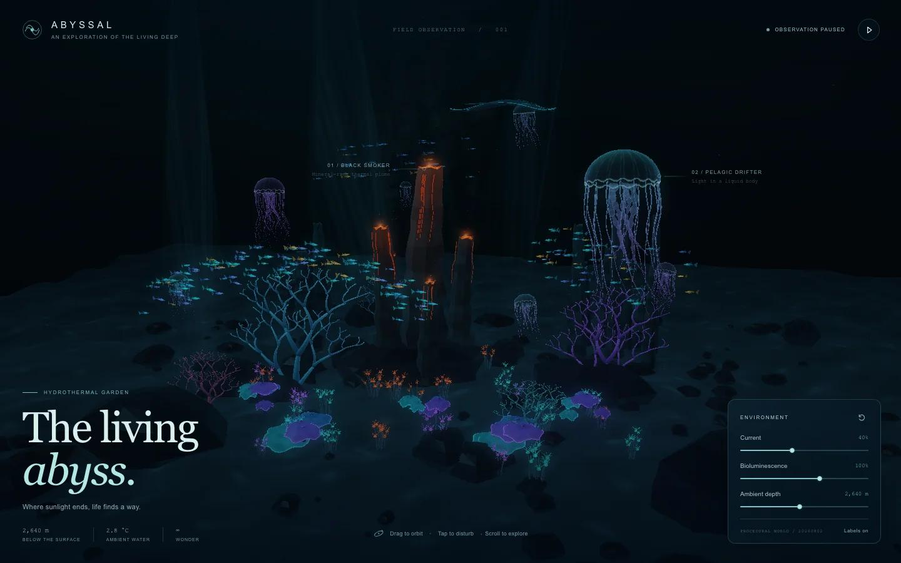</td>
    <td width="50%"></td>
  </tr>
  <tr>
    <td align="center"><sub>referência</sub></td>
    <td align="center"><sub>protótipo (gate V)</sub></td>
  </tr>
</table>

</details>

---

## Produção

O site público roda numa VPS pelo `infra/compose/compose.prod.yaml`: PostgreSQL, API, backup, Caddy e Cloudflare
Tunnel, **sem nenhuma porta aberta** na máquina. Merge na `main` é deploy: um cron compila a versão nova, troca, espera
a API ficar saudável e, se algo falhar, volta para a versão anterior. Detalhes em
[docs/VPS_DEPLOY.md](docs/VPS_DEPLOY.md).

<div align="center">
<br>
<sub>Nada aqui é roteiro. Toda história que aparece no abismo saiu das regras.</sub>
</div>
